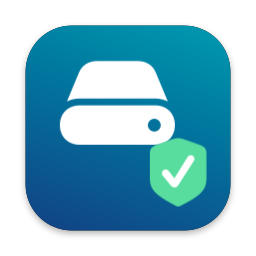
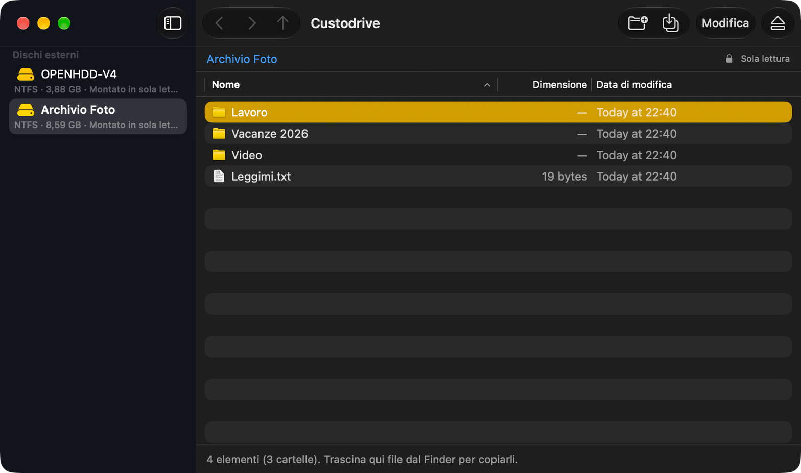
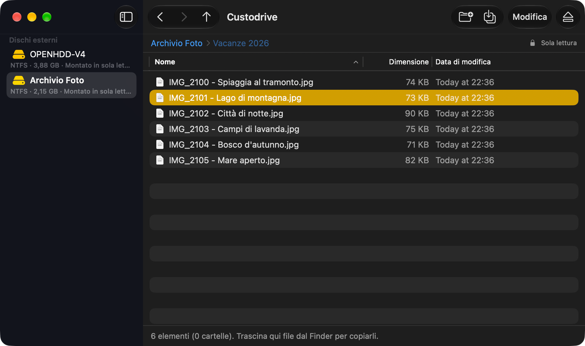
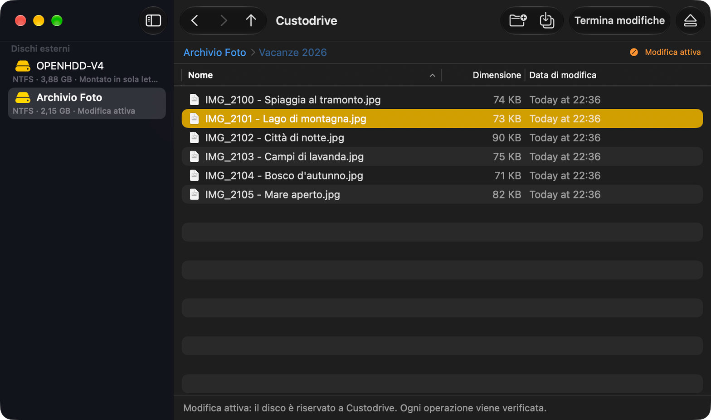
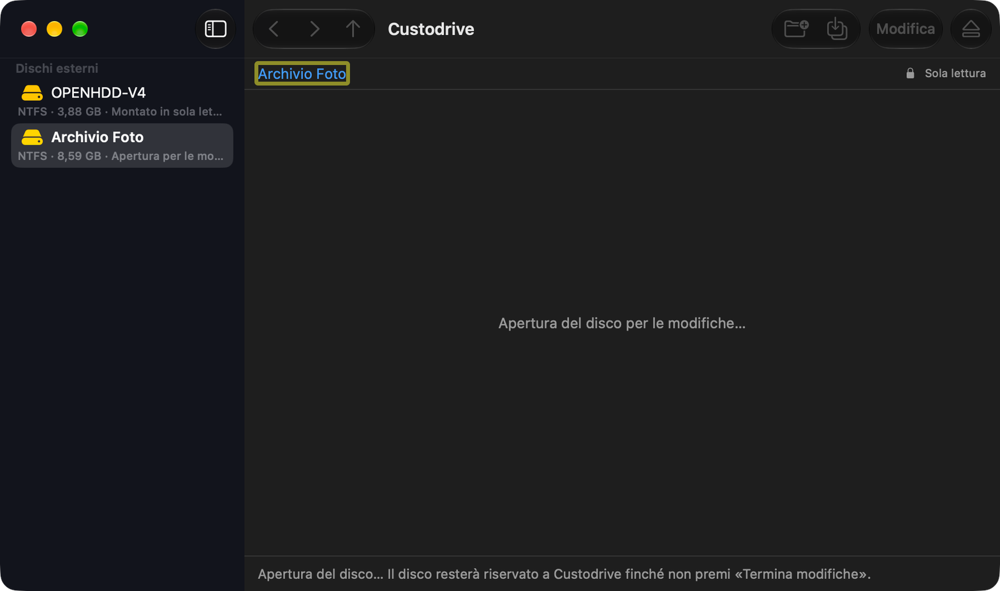
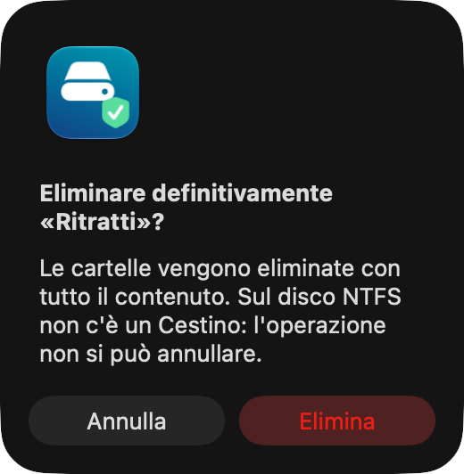

<p align="center">
  
</p>

<h1 align="center">Custodrive</h1>

<p align="center">
  <b>Verified copies on your external disks.</b><br>
  Read and write Windows (NTFS) disks and USB drives on your Mac,
  with every operation verified.
</p>

<p align="center">
  Apple Silicon Mac · macOS 15.4 or later · free, no drivers or subscriptions
</p>

<p align="center">
  <b>English</b> · <a href="README.it.md">Italiano</a> · <a href="README.es.md">Español</a>
</p>

---

macOS reads NTFS disks but cannot write to them. Custodrive lets you copy
photos and videos, create folders, rename, move and delete items on
Windows-formatted disks, through a Finder-like interface. Copies are read
back and verified. An interruption can still damage the filesystem: the
“needs checking” flag and recovery journal help recovery, but do not guarantee
there will be no data loss. Keep a backup of important data.

The interface supports **English (default), Italian and Spanish**. Use the
**Language** menu (globe icon) in the toolbar, or **Custodrive → Settings…**,
then restart the app to apply your choice. Existing edit sessions and copies
continue normally. Screenshots below show the Italian interface.

<p align="center">
  
</p>

## Contents

- [Getting started](#getting-started)
- [Features](#features)
- [How it protects your data](#how-it-protects-your-data)
- [Keyboard shortcuts](#keyboard-shortcuts)
- [Troubleshooting](#troubleshooting)
- [Requirements and limitations](#requirements-and-limitations)
- [Planned features](#planned-features)
- [For developers](#for-developers)

## Getting started

### 1. Install

1. Open `Custodrive-1.1.1.dmg` and drag **Custodrive** to **Applications**.
2. Open Custodrive from Applications.

**The first time on a new Mac**, macOS blocks it with “the developer cannot
be verified”: Custodrive is not distributed with an Apple Developer
certificate. Dismiss the alert, then go to **System Settings → Privacy &
Security** and click **Open Anyway** next to “Custodrive” at the bottom of
the page. Alternatively, in Terminal:

```sh
xattr -dr com.apple.quarantine /Applications/Custodrive.app
```

You only need to do this once per Mac.

### 2. Connect a disk and browse

Connect an NTFS disk or USB drive: it appears on the left under **External
Disks**. Select it and browse folders as in Finder. Until you make a change,
the disk remains mounted read-only and is also visible in Finder.

<p align="center">
  
</p>

### 3. Copy and edit

Drag files or folders from Finder into the window, or onto a folder.
On the first change, macOS asks for the **administrator password once**.
The disk then shows **Editing active**: it is reserved for Custodrive,
and each operation takes effect immediately.

<p align="center">
  
</p>

### 4. Finish and eject

When you are done, click **Finish Editing**: the disk becomes read-only again
and visible in Finder. Then use **Eject** before disconnecting it. Ejecting,
or quitting the app, also finishes the edit session automatically.

## Features

### Browse

- **Sidebar** with all external disks and their status (read-only, editing
  active, check required).
- **Column list** (name, size, date), sortable by clicking a header; folders
  always appear first.
- **Clickable path**, Back, Forward and Enclosing Folder buttons.
- **Double-click** to open a folder or file.
- **Quick Look** with the space bar, as in Finder.
- While **editing is active**, opening a file asks where to save a copy on
  your Mac. Changes in your editor stay there: to put them back on the NTFS
  disk, copy them with Custodrive. Quick Look previews are temporary and
  read-only.

### Copy from your Mac

- Drag files and **entire folders** from Finder: all subfolders are
  recreated. Mac service files (`.DS_Store`, `._*`) are skipped; symbolic
  links are not followed.
- Or use **Copy Files Here from Mac…**, right-click files in Finder →
  **Services → Copy to NTFS Disk with Custodrive**, or drag files onto the
  **Custodrive icon in the Dock**. Files go into the folder open in the app.
  Finder’s Services label follows the system language.
- Each file is **read back from the disk and compared** (SHA-256) with the
  original before it appears under its final name.
- **Existing files**: Custodrive asks whether to **Replace** or **Skip These**.
  The old file stays until the new one has been verified.
- **Existing folders**: copying a folder onto one with the same name asks
  first; **Merge** adds the new items and removes nothing.
- **Large copies** run in batches (1000 files or 8 GB at a time), with one
  progress bar, transfer speed and time remaining.

<p align="center">
  
</p>

### Organize

- **New Folder** (⇧⌘N): creates a folder with its name ready to edit.
- **Rename**: select an item, press Return and type directly in the list.
  Changes to letter case alone are supported.
- **Move**: drag items onto a folder, or press ⌘X and then ⌘V in the
  destination folder. Moves are immediate; data is not copied again.
- **Delete** (⌘⌫): files and folders with all their contents. NTFS has no
  Trash, so Custodrive always asks for confirmation.
- **Context menu** with all actions available by right-clicking.

<p align="center">
  
</p>

### Queue and cancellation

- Items dragged in while a copy is running are **queued** under the same bar.
- **Cancel** requests that the copy stop:
  - if rollback succeeds, the current batch is removed and the disk stays clean;
  - completed batches remain on the disk, verified;
  - the queue is cleared.

## How it protects your data

Custodrive uses these measures to detect errors and limit damage:

1. **The disk is marked “needs checking”** (NTFS dirty bit) before every
   change. The mark is cleared only when the operation is complete and
   verified. After an interruption, the mark calls for a Windows check;
   the result of `chkdsk` depends on the damage present.
2. **Nothing is overwritten in place.** New files are written separately
   and read back; only then do they receive their final names. A replacement
   keeps the old file aside until the new one is in place.
3. **A recovery journal** records replacements, moves and renames. After
   the filesystem check, Custodrive verifies the journal before completing
   or undoing the operation. If names, identities or contents are ambiguous,
   it refuses recovery and preserves what it finds.
4. **Unsafe disks are refused.** Custodrive does not write to disks with
   Windows hibernation or Fast Startup, an unclosed journal or an existing
   “needs checking” mark, and explains why.
5. **System files are protected.** `$MFT`, `System Volume Information`,
   junctions, symbolic links and encrypted files are never modified or
   followed.

Automated tests include I/O errors and simulated interruptions. Unreadable
cases or cases needing repair remain **inconclusive** until verified on
Windows. Historical Windows and USB tests concern earlier versions: they do
not automatically certify the current engine. Status and limitations:
[development notes (Italian)](docs/sviluppo.md).

## Keyboard shortcuts

| Action | Keys |
|---|---|
| Open folder or file | double-click, ⌘↓ |
| Enclosing folder | ⌘↑ |
| Back / Forward | ⌘[ / ⌘] |
| Quick Look | Space |
| Rename | Return |
| New folder | ⇧⌘N |
| Copy files here from Mac | ⇧⌘O |
| Cut (to move) / Paste | ⌘X / ⌘V |
| Delete | ⌘⌫ |

## Troubleshooting

**“Windows did not close the disk properly (NTFS journal open).”**
The disk was disconnected from Windows without safe removal. Reconnect it
to Windows, use **Safely Remove Hardware**, then try again on your Mac.

**“Windows is hibernating or Fast Startup is enabled.”** Shut Windows down
completely (not just sleep), or disable Fast Startup.

**“The disk needs checking on Windows.”** An operation was interrupted.
First save a copy of any data still accessible. On a disposable copy, or
after saving your data, open Windows Command Prompt as administrator and
run `chkdsk X: /f`, where X is the drive letter. `chkdsk` changes the
filesystem and does not guarantee recovery. **If Windows offers to format
the disk, decline.** Custodrive can resume only when the volume passes its
checks; an ambiguous journal needs manual investigation. Do not delete
`.OpenHDD-*` files to force it to resume.

**“Recovery paused — writes blocked.”** The app shows the reason, journal
entry and expected paths; it does not claim to have found files moved by
Windows. You can browse temporary files too, **Save Selected File** to
another disk, or **Open in Finder** read-only to copy folders. **Save
Report** keeps diagnostics, including private names. **Check Again**
revalidates the volume without writing: edits become available only if
all checks pass. If ambiguity remains, keep the original and journal and
seek assistance; there is no forced unlock.

**I cannot see the disk in Finder.** While editing is active, the disk is
reserved for Custodrive: click **Finish Editing**.

## Requirements and limitations

- Apple Silicon Mac (M1 or later), macOS 15.4 or later.
- External **NTFS** disks and USB drives. Use Finder for APFS, exFAT and FAT.
- Writes happen inside Custodrive, rather than directly in Finder: Finder
  sees the disk read-only.
- Files cannot be edited in place (for example, opening a document on the
  disk and saving it there): copy, replace or move them instead.
- Compressed or encrypted NTFS files are not written.

## Planned features

Custodrive aims to look after your disks, beyond providing an NTFS bridge.
Planned features:

- **Cloning** disks and USB drives, to keep a copy ready if a drive fails.
- **Synchronization** between a disk and a Mac folder (or another disk),
  with content verification.
- **Drive health checks**, to help detect failing drives early.

## For developers

```sh
Scripts/build-local-app.sh    # builds Build/Custodrive.app
Scripts/package-app.sh        # creates Build/Custodrive-1.1.1.dmg for sharing
sh Tests/run-localization-test.sh  # verifies the three shipped language catalogs
```

Builds, command-line engine, automated tests, Windows validation and project
history: [development notes (Italian)](docs/sviluppo.md). The NTFS engine is
based on [NTFS-3G](vendor/README.md).

Interface strings are in `Resources/Localization/{en,it,es}.lproj`.
English is the default and fallback. `CustodriveLanguage` stores the selected
language; a restart applies it to both SwiftUI and AppKit dialogs. Technical
diagnostics, paths and file names retain their original values.

## License

Custodrive is free software, released under the
[GNU General Public License, version 2 or (at your option) any later version](LICENSE)
(GPL-2.0-or-later). Its copy engine links [NTFS-3G](vendor/README.md) by
Tuxera, which uses the same license; the unmodified NTFS-3G source is in
`vendor/`. Custodrive comes with no warranty: keep a backup of important data.
